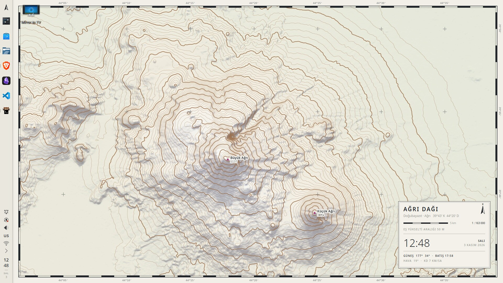
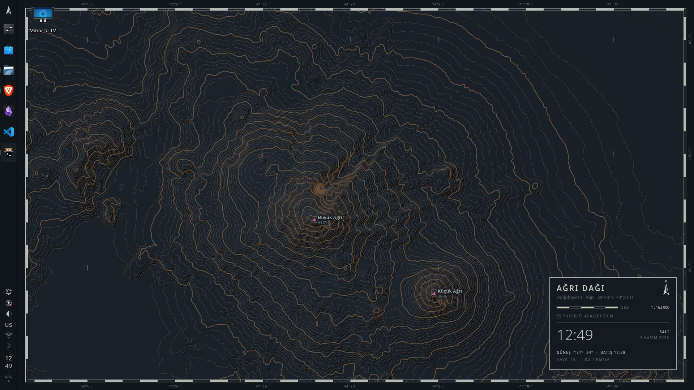
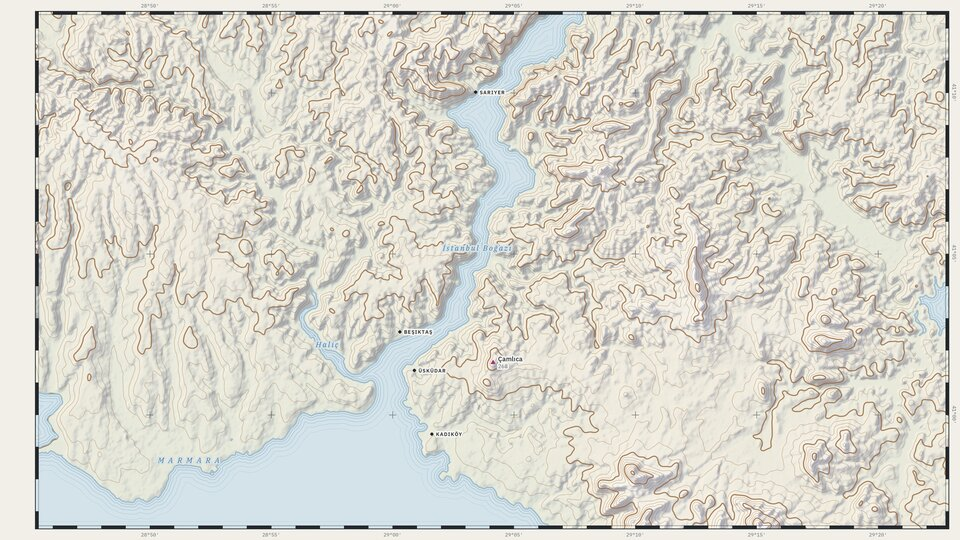
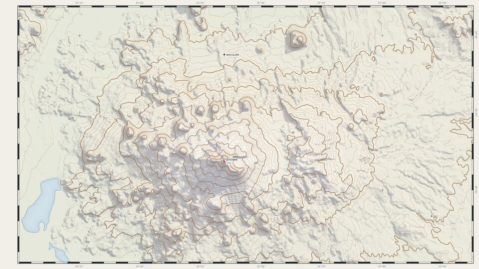
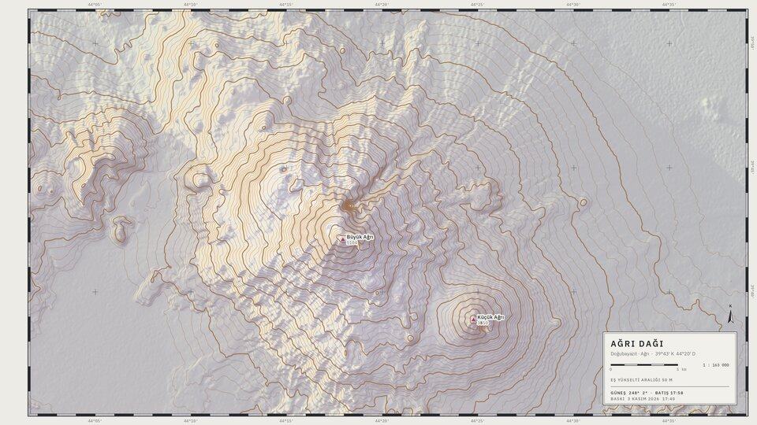

# Pafta

*Pafta* is Turkish for a map sheet. This KDE Plasma 6 rice turns the desktop into one: a survey sheet of real Turkish terrain, **reprinted every ten minutes under the real sun**. Shadows move across the mountains during the day and run long and gold at sunset. At night the sheet becomes a chart, lit by the moon at its real position and phase.





| | |
|---|---|
|  |  |
| İstanbul Boğazı, with water lines along the shore | Erciyes |
|  | |
| Ağrı Dağı at dusk: gold slopes, violet shadows | |

## What's in it

- **The print** (`bin/pafta-print`): shaded relief from the public SRTM elevation model (AWS Terrarium tiles), with sun and moon positions computed locally. It draws cast shadows, Imhof-style violet shadows and warm lit slopes, contours, water lines, a graticule frame with minute bands, and spot heights. The light's path is mirrored across the top of the sheet so the relief never reads inside out. `pafta-sun` and its timer print a new edition every 10 minutes.
- **The atlas** (`sheets/`): Ağrı Dağı, Nemrut, Erciyes, İstanbul Boğazı. A sheet is a small TOML file: centre, zoom, contour interval, labels. `osm = true` adds the OpenStreetMap plates (roads, bridges, rail, ferries, woods, exact water), as on İstanbul.
- **Rail**: one docked 48px panel on the left, the sheet's margin. It holds a north-arrow launcher, apps with graticule ticks (magenta for the active one), the tray, and `org.pafta.railclock` (hours over minutes, plus a calendar with sunrise and sunset).
- **Legend** (`org.pafta.legend`): the sheet's title block as a live widget. It shows the name, coordinates, a scale bar true to a 15.6" screen, the time, the sun or moon, and the weather (Open-Meteo). Click the name for the next sheet.
- **Plasma styles** `pafta-paper` and `pafta-night`: square legend-box popups with a keyline and an inner rule.
- **Window decoration** `PaftaPaper` / `PaftaNight` (Aurorae): square map insets, a 1px keyline, flush-left titles, thin glyph buttons.
- **Colour schemes** `PaftaPaper` / `PaftaNight`, generated from `palette.toml`. Every colour is a printing plate.
- **Apps**: kitty, Konsole, Kate/KWrite, VS Code (`apps/vscode/pafta-theme`), Neovim (`~/.config/pafta/nvim`), and a p10k prompt. All switch between paper and night.
- **Type**: IBM Plex Sans, Plex Mono, Plex Serif Italic (water names), BlexMono Nerd Font in the terminal.

- **Lock screen** (`plasma/lockscreen/org.pafta.lockscreen`): the desktop's legend box plus a password field, over the print with even margins. Picked through `plasmashellrc [Shell] ShellPackage`; a plasmashell drop-in names the desktop shell explicitly so plasmashell never loads the lock package, and the package falls back to `org.kde.plasma.desktop` regardless. `pafta-sun` keeps the box's sheet details current in `kscreenlockerrc`.
- **Login** (`sddm/`): the same box over a dawn, day, dusk or night print chosen by the sun at login. `sddm/build.sh && pkexec sddm/install-sddm-theme.sh`; undo with `pkexec sddm/revert-sddm-theme.sh`; try it first with `sddm/preview.sh`.

Design notes and rules are in [DESIGN.md](DESIGN.md).

## Install

Needs KDE Plasma 6 (Wayland), [uv](https://docs.astral.sh/uv/) (the renderer is a uv script with numpy, scipy and pillow), and these fonts in `~/.local/share/fonts`: [IBM Plex](https://github.com/IBM/plex/releases) Sans, Mono and Serif, and BlexMono from [Nerd Fonts](https://github.com/ryanoasis/nerd-fonts/releases). Icons: [Tela-circle](https://github.com/vinceliuice/Tela-circle-icon-theme) in the contour brown: `./install.sh 9A6A42` (not `-c`, which makes the folders circular).

With [Kigae](https://github.com/melihgurlek/Kigae) (live rice switching):

```sh
ln -s ~/Code/Rice ~/.config/kigae/manifests/pafta
ln -s ~/Code/Rice/kigae/pafta.toml ~/.config/kigae/manifests/pafta.toml
kigae install pafta && kigae apply pafta
```

Without it: `./install.sh` copies everything and applies the day look. `./install.sh --panels` also replaces your panels with the rail (it does not save your old layout).

Settings live in `~/.config/pafta/pafta.toml`, and all of them are optional:

```toml
lat = 41.01            # where the sun is computed for (default Istanbul)
lon = 28.98
screen_inches = 15.6   # for the true scale bar
size = "1920x1080"
rail = 48              # the print leaves this much margin on the left for the panel
sheet = "agri"
```

`pafta-sun next`, `pafta-sun sheet istanbul` and `pafta-sun sheets` turn the atlas. `pafta-print --at 2026-11-03T17:40 --out dusk.png` prints any moment.

## Credits

Elevation: SRTM via the [AWS Terrain Tiles](https://registry.opendata.aws/terrain-tiles/) open dataset. Roads, rail, ferries, woods and water on the İstanbul sheet: © [OpenStreetMap](https://www.openstreetmap.org/copyright) contributors, served as vector tiles by [OpenFreeMap](https://openfreemap.org). Weather: [Open-Meteo](https://open-meteo.com). Fonts: IBM Plex (OFL).

Designed and built by Claude for Melih Gürlek.
